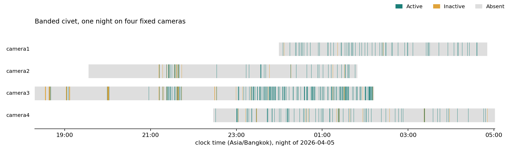
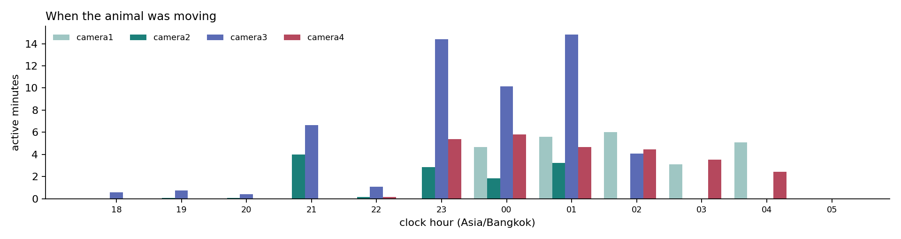

# Active and inactive on the banded civet footage

The second submission asks for a trained model, an explanation of it, and a
designed and evaluated output in the form of an active and inactive table or a
visualization. This page answers all three for the footage supplied for
`ชะมดแผงสันหางดำ` (banded civet), which is 25.59 hours from four fixed cameras on
one night.

The footage has no annotation. Nothing here says when the animal was eating, so
the three behaviour classes of Phase 2 cannot be scored on it. What a fixed
camera can measure by itself is whether the animal is in view and whether it is
moving, and that is what this page reports.

## The footage

| Camera | Clip | Recording starts | Hours | View |
|---|---|---|---:|---|
| camera1 | `A01_20260405235925` | 2026-04-05 23:59:25 | 4.86 | the stump and the gate, from above |
| camera2 | `A02_20260405193316` | 2026-04-05 19:33:16 | 6.26 | the potted plant and the fence |
| camera3 | `A03_20260405181806` | 2026-04-05 18:18:06 | 7.90 | the whole floor, fisheye |
| camera4 | `A04_20260405222742` | 2026-04-05 22:27:42 | 6.56 | the tyre, the door and the plant |
| **All** | 4 files | 18:18 to 05:01 | **25.59** | |

Every file is 1920 by 1080 HEVC at 30 frames per second and about 1.0 GB. The
four cameras watched the same enclosure on the same night, which is why the
figures below can put them on one clock.

## The model

The model is the Phase 2 classifier of
[ADR 0004](adr/0004-train-a-cnn-over-window-frames.md), trained here on the
activity labels instead of the behaviour labels.

| Item | Value |
|---|---|
| Backbone | ImageNet ResNet-18 from torchvision, frozen |
| Input | 8 frames per five-second window, cropped to the animal, 128 by 128 |
| Pooling | mean and max over the eight frames, concatenated |
| Head | dropout 0.3 and one linear layer |
| Trainable parameters | 2,050 |
| Loss | cross-entropy weighted by inverse class frequency |
| Optimiser | AdamW, learning rate 3e-4, weight decay 1e-4 |
| Epochs | 40 requested, early stopping on validation macro F1 with patience 10 |
| Classes | Active, Inactive |

Three choices matter and none of them is new.

The backbone is pretrained and frozen, and only the head trains, because a few
hundred windows cannot train a video network from scratch on a 4 GiB laptop GPU.

The window is eight frames rather than every frame, because the question is
whether the animal is moving, and eight samples of a five-second window show a
change of posture or of position while keeping a whole night's windows in memory.

The crop is the one addition this footage forced. The median box around the
animal is 216 pixels wide in a 1080p frame, which is 14 pixels after the 128 by
128 resize, and 14 pixels cannot show whether it is standing or lying down. `scripts/activity.py` already
knows where the animal is, so `scripts/frames.py` crops each window to that box
plus a quarter of its size on each side before the resize. Without the crop the
same run collapsed to predicting one class and scored validation macro F1 0.434.

## How a window is labelled

The label is a measurement, not an annotation. `scripts/activity.py` does four
things.

1. **One sample per second at 480 by 270.** ffmpeg decodes every frame, keeps one
   per second and scales it to a quarter of its resolution, so a seven-hour file
   costs one decode pass of about four minutes and 3.7 GB on disk.
2. **The empty enclosure is the median of the whole clip.** The animal is absent
   from most of a night, so the per-pixel median is the room with nothing in it.
   This is why a long recording is required rather than preferred: a five-second
   clip cannot supply it, and an adaptive background absorbs a still animal
   within a minute, which is exactly the case the table has to see.
3. **A box survives only if a neighbouring second corroborates it.** The mask is
   median-filtered, thresholded per pixel against the noise the clip measured,
   and a component must fall inside a size band, be animal-shaped and fill at
   least a third of its own box. A flying insect appears in one sample and is gone
   from the next; a civet persists.
4. **A five-second window is Active, Inactive or Absent.** Active when at least
   three of its five samples hold a box and the median speed is 0.05 body widths
   per second or more, or the silhouette churns by a fifth in a second. Inactive
   when it is present and neither holds. Absent when fewer than three samples hold
   a box.

A frame in which more than a fortieth of the view changed is counted as
**unmeasured** rather than read as an animal or as absence. On this footage that
catches the dusk segment of camera 3 and the infrared gain steps of the others:
an animal covers at most two percent of the view, and such a frame covers four to
twenty-four.

The definitions are in [the glossary](../GLOSSARY.md) and the reasoning is in
[ADR 0010](adr/0010-measure-activity-without-annotation.md).

## The active and inactive table

Shares are of each camera's recorded time. Present is Active plus Inactive. A bout
is a run of consecutive Active windows, and one window is five seconds.

| Camera | Recorded (h) | Present | Active | Inactive | Absent | Unmeasured | Active bouts | Median bout (s) | Longest bout (s) |
|---|---:|---:|---:|---:|---:|---:|---:|---:|---:|
| camera1 | 4.86 | 8.7% | 8.4% | 0.4% | 91.3% | 0.0% | 186 | 5 | 25 |
| camera2 | 6.26 | 4.6% | 3.3% | 1.4% | 95.4% | 0.0% | 103 | 5 | 35 |
| camera3 | 7.90 | 14.6% | 11.2% | 3.4% | 82.3% | 3.1% | 413 | 5 | 30 |
| camera4 | 6.56 | 8.1% | 6.7% | 1.4% | 91.9% | 0.0% | 222 | 5 | 40 |
| **All** | **25.59** | | **7.6%** | | | | **924** | | |

The animal was in view for 2.4 of the 25.59 recorded hours, 9.4 percent of the
night, and moving for 1.94 of them, 7.6 percent. Nearly all of the activity is in
bouts of one or two windows: the median bout is five seconds and the longest is
forty. That is a civet crossing a camera's view rather than settling in it.

Camera 3 sees the most of it, which is expected: it is the fisheye that covers the
whole floor, while the other three each watch one corner.

## The figures



Each row is one camera on the same clock. The grey is the enclosure with no animal
in it, the teal is the animal moving and the amber is the animal present and still.



The activity is concentrated between 23:00 and 02:00, with a second cluster near
21:00. Camera 3 stops recording at 02:07 and camera 2 at 01:49; only camera 1 is
still recording after 04:00, and it sees the animal for a few more minutes.

## Evaluating the output

The evaluation has two parts, because the label source is a measurement and a
model scored against its own teacher proves only that it learned the teacher.

### The model on a camera it never saw

Cameras 1 and 2 train, camera 3 selects the epoch and the abstain threshold, and
camera 4 is held out: a whole viewpoint the model never trained on.

| Split | Camera | Windows | Active | Inactive |
|---|---|---:|---:|---:|
| Train | camera1, camera2 | 515 | 440 | 75 |
| Validation | camera3 | 829 | 636 | 193 |
| Test | camera4 | 383 | 317 | 66 |

The threshold is chosen on camera 3 and applied to camera 4 once. It is chosen
under a cap of 10 percent on the share of validation windows left undecided, and
the cap is spent: on camera 3 the threshold is 0.60 and leaves 61 of 829 windows
(7.4 percent) without an answer. Applied to camera 4, it abstains on 29 of 383
windows (7.6 percent).

| Threshold rule | Threshold | Abstained | Accuracy over decided | Active P | Active R | Active F1 | Inactive P | Inactive R | Inactive F1 | Macro F1 |
|---|---:|---:|---:|---:|---:|---:|---:|---:|---:|---:|
| best macro F1, no cap | 0.00 | 0 (0.0%) | 0.755 | 0.921 | 0.770 | 0.838 | 0.381 | 0.682 | 0.489 | 0.664 |
| 10% abstain cap | 0.60 | 29 (7.6%) | 0.777 | 0.921 | 0.738 | 0.820 | 0.410 | 0.621 | 0.494 | 0.657 |

Support is unchanged by the threshold: 317 Active and 66 Inactive windows.

Abstaining moves 14 wrong "still" answers out of the table: Inactive predictions
fall from 118 to 100, and the wrong ones from 73 to 59. It costs 0.007 of macro
F1 and 0.032 of Active recall, because 10 moving windows that were called Active
are now undecided. The other 14 abstentions on moving windows were the wrong
"still" calls the change exists to remove. Accuracy over decided windows rises
from 0.755 to 0.777. That is the trade this page reports: a slightly lower score
for fewer false "still" rows.

| true \ pred | Active | Inactive | abstain |
|---|---:|---:|---:|
| Active at 0.00 | 244 | 73 | 0 |
| Inactive at 0.00 | 21 | 45 | 0 |
| Active at 0.60 | 234 | 59 | 24 |
| Inactive at 0.60 | 20 | 41 | 5 |

The error is still not symmetric. At 0.60, Inactive precision is 0.410, so 59 of
the 100 Inactive answers are moving windows, against 73 of 118 at 0.00. Active
recall gives up the 0.032 because 24 moving windows are left undecided. The model
is conservative about calling an animal still, which is the safer direction for a
table read as "the animal was not moving", and abstaining narrows that error at a
small score cost.

Predicting Active every time would score macro F1 0.453, so the model carries
0.21 of macro F1 over the majority class on a viewpoint it never saw at 0.00, and
0.20 at the capped threshold.

Validation on camera 3 is higher, at macro F1 0.804 with nothing abstained and
0.779 at the 0.60 threshold. The gap to camera 4 is what a held-out viewpoint
costs. Camera 3 is the fisheye that sees the whole floor, camera 4 sees one
corner, and the model had never seen either.

The training set is 75 Inactive windows against 440 Active, so Inactive is the
minority class by six to one. The inverse-frequency loss weight is what keeps the
model from ignoring it, and the low Inactive precision is what that costs.

### Motion frames on the same split and budget

The label is made of movement, so the run above was repeated with the absolute
difference between consecutive sampled frames appended to the eight still frames:
sixteen frames per window, same split, seed 0 and 40-epoch budget, camera 4 scored
once.

| Camera 4 (held out) | Frames | Active precision | Active recall | Inactive precision | Inactive recall | Macro F1 |
|---|---:|---:|---:|---:|---:|---:|
| Still frames | 8 | 0.921 | 0.770 | 0.381 | 0.682 | 0.664 |
| Still and difference frames | 16 | 0.921 | 0.738 | 0.357 | 0.697 | 0.646 |

The extra frames did not help. Macro F1 fell by 0.018 and Inactive precision by
0.024, while Active precision held and Active recall gave up 0.032. On this
footage and budget the model did not turn the difference frames into a better
separation, so this is recorded as a negative result and `--motion` stays off by
default. The run is kept as `outputs/activity/evaluation-motion.md`, and its
checkpoint records sixteen frames so it cannot be confused with the eight-frame
run. Both rows were scored at the unconstrained threshold, 0.00, so the
comparison isolates the frames.

### The visual audit

A measurement is only as good as what it looked at, so 24 windows of each state
were sampled evenly across the four cameras, decoded at full resolution, cropped
around the box the scan found, and read by eye. `scripts/audit_activity.py` makes
the sheets, and they are committed as
[Active](figures/audit-active.jpg), [Inactive](figures/audit-inactive.jpg) and
[Absent](figures/audit-absent.jpg).

| State | Windows read | Held the animal | Notes |
|---|---:|---:|---|
| Active | 24 | 24 | every box held the animal or part of it, including a tail behind the stump |
| Inactive | 24 | 23 | one box on a shadow beside the plank in camera 3 |
| Absent | 24 | 2 | one passing animal that held fewer than three of five samples, one in camera 3's dusk segment |

The two Absent windows that held an animal are the honest misses. One is a civet
crossing camera 4 in about four seconds, which holds fewer than three of the five
samples and is therefore labelled Absent by the window rule; the other is in
camera 3's dusk segment, where the frame is counted as unmeasured and the window
falls out as Absent. Both are boundary cases of the rule rather than silent
failures, and both are visible on the sheet.

The single Inactive false positive is a shadow beside the plank that the
background model sees as a still silhouette. It is the failure the audit exists to
count.

## Limits

- Active and Inactive are not Eating, Locomotion and Resting. They are not
  comparable with the Phase 2 test macro F1 of 0.949 and do not replace it.
- The model is scored against the measurement it was trained on. Agreement with
  that teacher on an unseen camera is not accuracy against a human label.
- One night, one enclosure, four cameras. Nothing here estimates a second night.
- A civet that lies still for most of a recording is absorbed by the median and
  cannot be seen at all. The measurement sees movement and presence, not rest that
  never moves.
- A box on a swaying plant survives the persistence filter. The audit is the only
  defence, and it samples.
- The median bout is one window, so the table cannot separate a real short visit
  from a detection that dropped out for a window. Bout counts are an upper bound.
- The model assumes the animal is in view, because it is trained on present
  windows only. Presence stays the measurement's job.

## Reproduce

From the repository root, with the four camera files under one folder:

```
python3 scripts/activity.py --clips <folder> --out outputs/activity
python3 scripts/activity_report.py
python3 scripts/train.py --windows outputs/activity/windows.csv \
  --source-clips outputs/activity/source-clips.csv --clips-root <folder> \
  --classes Active,Inactive --boxes outputs/activity/frames.csv \
  --out outputs/activity/model.pt
python3 scripts/evaluate.py --windows outputs/activity/windows.csv \
  --source-clips outputs/activity/source-clips.csv --clips-root <folder> \
  --boxes outputs/activity/frames.csv --model outputs/activity/model.pt \
  --max-abstain 0.10 \
  --report outputs/activity/evaluation.md --json outputs/activity/evaluation.json
python3 scripts/audit_activity.py --clips <folder> --state Active
```

For the motion comparison, add `--motion` to the training command and point
`--model` at the checkpoint it writes. The checkpoint records the frame count, so
`evaluate.py` decodes the input the weights were trained on.

The scan decodes the footage once and caches it under `outputs/activity/cache`;
`--retune` reuses that cache to re-apply thresholds without decoding again.
